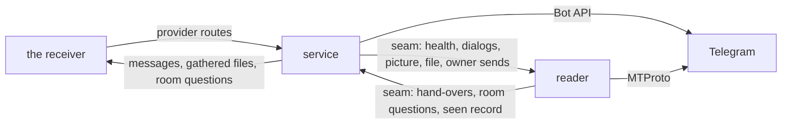

# The Telegram provider's boundary

This document is the boundary of `bmo-telegram`: every route it serves, every call it makes on another unit,
the seam between its two processes, and the configuration it reads. A unit reaches this provider only across
it, and the provider reaches another unit only by the calls below.

The provider is two processes of one repository:

- **the service**, the Rust package at the root. It is the chat provider bmo-chat's contract describes: it
  holds the bot account's connection to the Telegram Bot API, declares the provider, performs the send verbs,
  runs the dialect and hands what its rooms say to the receiver. It is the only process another unit talks to.
- **the reader**, the bun package in `reader/`. It holds the owner's own Telegram account over MTProto, read
  only, for what the bot account cannot see or fetch, and for the sends made in the owner's own words
  (`docs/reader.md`). Only the service calls it, over the loopback.

## Routes served

### The chat protocol's provider routes

Every provider route of bmo-chat's `docs/protocol.md`, served by bmo-chat's provider server exactly as the
protocol and its `docs/openapi/provider.json` state them, under the service's token. `docs/api.md` states the
fixed contract and `docs/openapi.json` carries it.

| Route | What it answers |
|---|---|
| `GET /declaration` | the provider's declaration (`docs/telegram.md`, 「The declaration」) |
| `GET /health` | `ready` once the bot account's connection is open; the reason while it is not |
| `POST /sends` | one send, any of the twelve verbs (`docs/telegram.md`, 「Sends」) |
| `GET /rooms` | a page of the bot's rooms and the rooms the owner's account is in, the latter asked of the reader (`docs/telegram.md`, 「The rooms」); refused `unsupported-capability` while `roomList` is not declared |
| `POST /rooms` | a conversation started by the owner's account, a one-to-one with a contact or a group of contacts, answered with its room (`docs/telegram.md`, 「Contacts and starting a conversation」); refused `unsupported-capability` while `startChat` or `startGroup` is not declared |
| `GET /contacts` | a page of the owner's account's contacts, asked of the reader, each with the one-to-one the account has with it; refused `unsupported-capability` while `contactList` is not declared |
| `GET /rooms/{roomId}` | what the provider knows of the room: whose it is, the bot's number where the bot is in it and null where it is not, its kind, its person and its title |
| `GET /owner` | the owner's one-to-one, numbered by the owner |
| `GET /rooms/{roomId}/messages/{messageId}/files` | the pictures and files a message carried, fetched again through the reader under the ids they crossed with |
| `POST /dialect/readings` | the `telegram-html` dialect reading markdown |
| `POST /dialect/checks` | the `telegram-html` dialect checking markup it built |
| `GET /avatars` | a page of the profile pictures the reader keeps, each with when it was taken |
| `GET /rooms/{roomId}/avatar` | a room's kept profile picture, as `image/jpeg` bytes |
| `GET /people/{personId}/avatar` | a person's kept profile picture, as `image/jpeg` bytes |

Wire conventions, auth, the error shape and the retry rule are the protocol's.

### This repository's own routes

Beside the protocol, under the same token and the protocol's conventions and error shape:

| Route | Answer |
|---|---|
| `GET /status` | what stands of each part, each a `standing` (`active` or `inactive`) and a `reason` (an English sentence, or null): `bot`, `reader`, `history`, `avatars` |
| `GET /messages` | query `chat` (a number, or a name or a handle), `max` (1 to 200, 50 where absent), `since` (epoch milliseconds, or absent): one chat's recent messages, asked of the reader, newest first; a name that means exactly one chat reads it, and one that could mean several answers `candidates`, each `chatId`, `name` and `kind` (`room` or `contact`), for the owner to pick among; 404 `not-found` with the reason where the account cannot resolve the chat, 503 `not-ready` with the reason while the reader does not answer |

The status route is for the provider's own operators; no other unit reads it, and it is not part of the fixed
API (`docs/api.md`). The read route is the backend of the hosted tool `bmo/telegram_messages`
(`docs/tools.md`): one chat's recent messages on the owner's word alone, read-only and with nothing sent into
the chat. A name that means exactly one chat is read; a name that could mean several answers the owner's
account's chats and contacts, so the owner picks one by number. The tool reaches the route over the loopback
with the token and
port from `env/telegram.env` under the data root; the route itself takes the service's token like the status
route.

## Calls made on the receiver

### The chat protocol's receiver routes

The provider reaches the receiver only through bmo-chat's `ChatReceiverLink`, at the receiver's base address and
with the receiver's token, as the protocol states it. It holds no client of its own for the receiver.

| Route | What it carries |
|---|---|
| `GET /rooms?via=telegram` | a page of the rooms whose past the reader may walk back, each with the oldest message the receiver holds and when it was sent |
| `GET /rooms/{roomId}?via=telegram` | whether the receiver listens to a room, whether it asked for the room to be read (`read`), and its oldest message; 404 `not-found` reads as a room it does not listen to and did not ask to be read |
| `PUT /rooms/{roomId}/messages/{messageId}` | a message, whatever its origin: `live`, `edit` or `history`, with its files where they are already gathered, or `gathering` where they follow |
| `PATCH /rooms/{roomId}/messages/{messageId}` | the files a message's gathering promised, or why they were not kept |
| `POST /avatar-changes` | the rooms and people whose kept profile picture changed |
| `POST /typing-marks` | a person writing in a room now, or no longer, with the policy's six-second life (`docs/telegram.md`, 「Typing and presence」); the link drops it unsent while `peopleTyping` is not declared |
| `POST /presence-changes` | whether people are reachable now, one person as their status changes or every person told of as a whole list; the link drops it unsent while `presence` is not declared |

What the provider hands over:

- **Telegram's own payload** for a message of a listened room, as Telegram wrote it, crosses as the context's
  `metadata`.
- **A file crosses as bytes.** Where it is kept is the receiver's. The provider keeps no copy of a file it
  hands over.
- **A file a message carried crosses as a message file,** with its id, the same each time the same file
  crosses, a fetch through `GET /rooms/{roomId}/messages/{messageId}/files` included, and with the kind of file
  it is as far as Telegram says (`docs/telegram.md`, 「Reading a room」).
- **The room's title** crosses as the context's `roomTitle`, the room facts (`kind`, `identity`, `privateTo`)
  with every hand-over, and the message's time in epoch milliseconds. A hand-over from a room the bot is not in
  carries the facts the room's own answer gives (`docs/telegram.md`, 「The rooms」): where the receiver does not
  read the room, the service takes off the `identity` the reader gave; where it reads it, the service keeps the
  identity and takes off `privateTo`.

Where the receiver does not answer, the provider's fallback is the boundary's: a room it says nothing of counts
as listened, a room it answers 404 for is not listened to, and a `GET /rooms` that fails stands the history walk
down, which `GET /status` says under `history`. Word of changed pictures that does not go stands that part down
the same way, while the pictures stay current.

## The seam between the service and the reader

Both processes listen on the loopback only. Every seam route takes the service's token as its bearer and
answers 401 without it. Bodies are JSON in camelCase; times are integers of epoch milliseconds; ids are
signed 64-bit integers; bytes are base64. A failure is answered with the protocol's error shape.

### The reader's routes, called by the service

| Route | Body | Answer |
|---|---|---|
| `GET /health` | | `connected` (boolean), `reason` (string or null): whether the owner's account is connected, and why not |
| `GET /reader/avatars` | | `avatars`, each `kind` (`room` or `person`), `id` and `takenAt` (when the kept picture was taken) |
| `GET /reader/dialogs` | | `rooms`, each `chatId` and `title` (string or null): every chat the owner's account is in, numbered as the service numbers it; 503 `not-ready` with the reason while the account is not connected |
| `GET /reader/contacts` | | `contacts`, each `id`, `name`, `bot` (boolean) and `chatId` (number or null, the one-to-one the account has with it): the account's contact list; 503 `not-ready` with the reason while the account is not connected |
| `POST /reader/start` | `contactId`, or `title` and `contactIds` | `outcome`: `started` with `chatId` and `title`; `no-contact` with `contactId`; `refused` with `reason`, Telegram's own words; 503 `not-ready` with the reason while the account is not connected |
| `GET /reader/messages` | query `chat` (a number), `max` (1 to 200, 50 where absent), `since` (epoch milliseconds, or absent) | `messages`, each `messageId`, `senderId` (number or null), `senderName`, `sentAt` (epoch milliseconds) and `text`, newest first, a non-text line carrying its kind's placeholder; 404 `not-found` with the reason where the account cannot resolve the chat; 503 `not-ready` with the reason while the account is not connected |
| `GET /reader/members` | query `chat` (a number) | `members`, each `id` (the person's number, the sender number their messages carry) and `name`: everyone the owner's account lists in the chat, the account itself under the owner's number; 404 `not-found` with the reason where the account cannot resolve the chat; 503 `not-ready` with the reason while the account is not connected |
| `POST /reader/picture` | `chatId`, `messageId`, `sentAt` (number or null): the message by the number the receiving side holds it under, which the reader turns back into the account's own where the room numbers per account | `outcome`: `fetched` with `id`, `name`, `mime`, `bytes`, a message file under the owner's account's id; `unavailable` with `reason`; `no-reader` with `reason` |
| `POST /reader/file` | `chatId`, `messageId`, `sentAt` | the same outcomes |
| `POST /owner/say` | `chatId`, `text` (the plain words), `markup` (the dialect's HTML, or null), `silent` (boolean), `replyToMessageId` (number or null) | `messageId`, the number the receiving side will hold the line under (`docs/reader.md`, 「Numbers」), and `text`, the words as Telegram holds them; or `refused` (`unavailable` or `unreachable`) with `error` |
| `POST /owner/album` | `chatId`, `files` (each `name`, `mime`, `bytes`), `caption` (the plain words), `captionMarkup` (the dialect's HTML, or null), `replyToMessageId` | `ids`, the numbers the receiving side will hold the files' messages under, in the order the files went, and `texts`, the words each holds as Telegram holds them; or `refused` with `error` |
| `POST /owner/typing` | `chatId`, `on` (boolean) | an empty object once the typing mark is shown or taken off; or `refused` (`unavailable`) with `error` |
| `POST /owner/delete` | `chatId`, `messageId` | an empty object once the message is deleted for everyone; or `refused` (`unavailable`, or `gone` where the account holds no line for the number named, once it is turned back where the room numbers per account) with `error` |
| `POST /owner/reaction` | `chatId`, `messageId`, `emoji` (an empty one takes the account's reaction off) | an empty object once the reaction stands as the account's, or is taken off; or `refused` (`unavailable`, or `gone` where the account holds no line for the number named) with `error` |
| `POST /owner/pin` | `chatId`, `messageId`, `on` (boolean), `silent` (boolean) | `messageId`, the account's own number of the service message Telegram wrote for the pin, or null where it wrote none; or `refused` (`unavailable`, `gone` where the account holds no line for the number named, or `turned-down` with Telegram's own words) with `error` |
| `POST /owner/edit` | `chatId`, `messageId`, `text` (the plain words), `markup` (the dialect's HTML, or null) | `messageId`, the account's own number for the line, `text`, the words as Telegram now holds them, and `edited` (false where the line already said them); or `refused` (`unavailable`, `gone` where the account holds no line for the number named, `not-own` where the line is not the account's own, or `turned-down` with Telegram's own words) with `error` |
| `POST /owner/line` | `chatId`, `senderId`, `sentAt` (epoch milliseconds, whole seconds), `words` (the SHA-256 of the line's words, lowercase hex) | `messageId`, the account's own number for the one line of the room it holds from that sender at that second with those words; or `refused` (`unavailable`, or `gone` where it holds no such line or more than one) with `error` |

The service answers `GET /rooms` from `/reader/dialogs` and the rooms the bot is in (`docs/telegram.md`, 「The
rooms」): each room once, as a room of the provider's own, `owner` for the owner's one-to-one and `group` for any
other, the account's title for it. Where the bot is in it, the identity is the bot's number, the person of a
one-to-one is `privateTo`, and `modes` are the declaration's active voices. Where the bot is not in it, the
receiver is asked whether it reads the room, eight rooms at a time: a room it reads carries the bot's number as
the identity, no `privateTo`, and `human-reader` and `human-avatar` as `modes`; any other carries no identity,
the person of a one-to-one as `privateTo`, and `human-reader` alone. The mode a room was added in is the
receiver's. bmo-chat's provider server orders and pages the list; a reader that does not answer it is a failure
of the route. Whether the bot is in a group or a channel is asked of the Bot API, `getChatMember` with
the bot's own number; a one-to-one is the bot's where its person has written to the bot privately, by the
service's own record, and no Bot API call answers it.

The service answers `GET /rooms/{roomId}/members` from `/reader/members` where the owner's account lists the room among its dialogs, and from the Bot API where the bot is in it: `getChatAdministrators` for a group or a channel, and `getChatMember` for each sender the service's record holds of the room, eight at a time, the senders of the
room's last two hundred lines as `/reader/messages` answers them added to that record first where the account is
in the room; a one-to-one of the bot's is its person, named by `getChat`, and the bot, named by `getMe` (`docs/telegram.md`, 「The members of a room」).

A picture or a file past the Bot API's ceiling for a bot is fetched by `/reader/picture` or `/reader/file`. A
send in the owner's account, one naming the voice `human-reader` or `human-avatar`, goes by `/owner/say` and
`/owner/album` (whose files cross inline as base64, so a file the service holds on its own disk is read whole for
that one call), divided by the service first into the parts, markup and albums the bot's send would take, the
avatar's prefix already put before its words (`docs/telegram.md`, 「The owner's voice」, 「The avatar」); its typing
mark goes by `/owner/typing` and a delete by `/owner/delete`; a reaction, a pin and an edit in the owner's own
voice go by `/owner/reaction`, `/owner/pin` and `/owner/edit`. The reader sends the markup as HTML where one is
given, and `/owner/say` and `/owner/edit` the plain words where the account refuses it. Every number a reply or
an act names reaches the reader as the receiving side holds it; the reader points at the account's own line for
it once the number is the account's own: a provider number of a room that numbers per account it turns back by
its own arithmetic (`docs/reader.md`, 「Numbers」). A number of the bot account's never comes this way raw: where
the receiving side names one, the service first asks `/owner/line` for the account's number by the line's stamp
out of its ledger (`docs/telegram.md`, 「The owner's voice」), and a reply whose line cannot be pointed to is
refused `unreachable` rather than sent without the reference the caller asked for.
The service notes each message the send went out as, each edit and each pin's service message, under the number
and the words the reader answered, so that the bot account's sight of it is not handed to the receiver a second
time.

### The service's routes, called by the reader

| Route | Body | Answer |
|---|---|---|
| `POST /reader/inbound` | `kind` `message` with `roomId`, `messageId` (the line's number as the provider numbers it, `docs/reader.md` 「Numbers」) and a handed message as the protocol states it, or `kind` `gathered` with the same `roomId` and `messageId` and a `patch` (`files`, or `gatherFailure`) | `{}` once the service has handed it on, and for a message whose origin is `history` `kept`; the receiver's failure in the error shape. A body up to 48 MiB is taken, so a gathered file of up to the receiver's 25 MiB cap crosses whole as base64 |
| `POST /reader/listened` | `chatId` | `listened` (boolean), the receiver's answer or its fallback; `people` (boolean), whether a person's words in the room are the reader's to hand over: the bot is not in the room and the receiver asked for it to be read (`docs/telegram.md`, 「The rooms」); `tells` (boolean), whether its people's typing and presence are the reader's to tell: the room is listened to and either the bot is in it or the receiver asked for it to be read (「Typing and presence」) |
| `GET /reader/rooms` | | `rooms`, each `chatId`, `oldestMessageId` and `oldestSentAt`, as the receiver answers them; 503 `not-ready` with the reason while the receiver does not say |
| `POST /reader/reactions` | `roomId`, `messageId` or `stamp` (`senderId`, `sentAt`), `reactions` (each `personId` and `emojis`) and `whole` | `{}` once the service has handed it on as a reaction change; the receiver's failure in the error shape |
| `POST /reader/deleted` | `roomId`, `messageIds` and `stamps` (each `senderId` and `sentAt`) | `{}` once the service has handed it on as a deletion; the receiver's failure in the error shape |
| `POST /reader/typing` | `roomId`, `personId`, `on` (boolean) | `{}` once the service has handed it on as a typing mark under the policy's life; the receiver's failure in the error shape |
| `POST /reader/presence` | `people` (each `personId`, `state` and `lastSeenAt`, a number or null) and `whole` | `{}` once the service has handed it on as a presence change; the receiver's failure in the error shape |
| `GET /reader/seen` | | `rooms` and `people`: every room and sender the provider has handed a message of over or sent into |
| `POST /reader/avatars` | `rooms`, `people` | `{}` once word of the changed pictures has gone to the receiver, or stood down |

A live message carries the room and the sender, and the sender as one of that room's, into the record of what the
provider has seen; an edit adds neither, and a line out of a room's history adds its sender as one of the room's
alone. A message the reader hands on from the owner's
number, in a room the bot is in, whose words begin with the avatar prefix goes on as the agent's own
(`docs/telegram.md`, 「The avatar」). The reader opens the owner's account only once
the service answers, so nothing it reads is handed to a service that is not up.

## Configuration

Both processes read the same environment, which the deployment's env file supplies. Kept as the platform's
credentials have always been named:

| Variable | Read by | Meaning |
|---|---|---|
| `BMO_BOT_TOKEN` | both | the bot account's token; the provider is not configured without it. The reader reads only the bot's number off it, the part before the colon |
| `BMO_OWNER_ID` | both | the owner's Telegram number, which is also the number of the owner's one-to-one with the bot; required |
| `BMO_TELEGRAM_API` | service | the Bot API's base address; `https://api.telegram.org` where unset |
| `BMO_TG_API_ID` | reader | the owner's application id for MTProto |
| `BMO_TG_API_HASH` | reader | the owner's application hash for MTProto |
| `BMO_TG_SESSION` | reader | the owner's session, as the login script writes it; the reader mode is inactive until all three are set |

This provider's own:

| Variable | Read by | Meaning |
|---|---|---|
| `BMO_TELEGRAM_PORT` | both | the loopback port the service listens on; 3220 where unset |
| `BMO_TELEGRAM_TOKEN` | both | the bearer every route of the service and of the reader takes; required |
| `BMO_TELEGRAM_RECEIVER_URL` | service | the receiver's base address; required |
| `BMO_TELEGRAM_RECEIVER_TOKEN` | service | the token the receiver's routes take; required |
| `BMO_TELEGRAM_READER_PORT` | both | the loopback port the reader listens on; 3221 where unset |
| `BMO_TELEGRAM_DATA` | both | the provider's own data folder, inside no checkout; required. It holds the profile pictures and their record, the history walk's progress, the rooms and senders seen, each room's own senders, and the people who wrote to the bot privately, the id each picture and file the bot account handed over crossed with, the ledger of whose numbering each line of a room numbered per account stands under (`docs/telegram.md`, 「The owner's voice」), the lock that keeps the owner's session to one process, and the `spool/` folder each file of a multipart send stands in as it arrives and each file gathered past the Bot API's ceiling stands in until the receiving side took it |
| `BMO_TELEGRAM_PICTURE_ROOT` | service | the folder a picture or an album item named by a file path may be read from; where unset, only a web address or an inline file is sent |
| `BMO_TELEGRAM_STICKER_SET` | service | the Telegram sticker set a `sticker` send picks from by its emoji; where unset, a sticker send naming an emoji is refused saying no set is configured |
| `BMO_TELEGRAM_AVATAR_PREFIX` | service | the prefix the agent's words carry in the `human-avatar` voice where a send names none, and by which a line of the owner's account is read back as the agent's (`docs/telegram.md`, 「The avatar」); where unset or blank, the policy's own prefix |

## Statements about siblings

- **The gate** still says this provider folds a reply's parts by its own code and is to ask `POST
  /formats/decided`. bmo-chat's fixed protocol makes the fold decision the sender's and carries it to the
  provider as the send's `fold`; the provider applies its dialect and asks no gate.
- **The receiver** now states every route under 「The chat protocol's receiver routes」, so no call here waits
  on a route it does not serve.

A reply in the owner's own voice is named by the message's number, as the protocol carries it. The owner's
account must be able to point at one line under that number, once it is turned back where the room numbers per
account or looked for by its stamp where it is the bot account's own; where it cannot, the send is refused
`unreachable` rather than sent without the reference the caller asked for.
