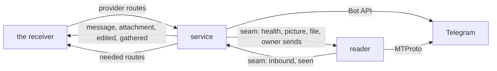

# The Telegram provider's boundary

This document is the boundary of `bmo-telegram`: every route it serves, every call it makes on another unit,
the seam between its two processes, and the configuration it reads. A unit reaches this provider only across
it, and the provider reaches another unit only by the calls below.

The provider is two processes of one repository:

- **the service**, the Rust package at the root. It is the chat provider bmo-chat's contract describes: it
  holds the bot account's connection to the Telegram Bot API, declares the provider, performs the send verbs,
  runs the dialect and hands what its rooms say to the receiver. It is the only process another unit talks to.
- **the reader**, the bun package in `reader/`. It holds the owner's own Telegram account over MTProto, read
  only, for what the bot account cannot see or fetch, and for the sends made in the owner's own words
  (`docs/reader.md`). Only the service calls it, over the loopback.

## Routes served

### The chat protocol's provider routes

Every provider route of bmo-chat's `docs/protocol.md`, served by bmo-chat's provider server exactly as the
protocol and its `openapi.json` state them, under the service's token:

| Route | What it answers |
|---|---|
| `GET /declaration` | the provider's declaration (`docs/telegram.md`, 「The declaration」) |
| `GET /health` | `ready` once the bot account's connection is open; the reason while it is not |
| `POST /send` | one send, any of the twelve verbs (`docs/telegram.md`, 「Sends」) |
| `POST /media` | a picture or a file a message carried, fetched again through the reader |
| `POST /dialect/read` | the `telegram-html` dialect reading markdown |
| `POST /dialect/check` | the `telegram-html` dialect checking markup it built |
| `POST /room/owns` | whether the room is one this provider has handed a message from or sent into |
| `POST /room/identity` | the bot account's number, the same in every room |
| `POST /room/is-owner` | `owner` for the owner's one-to-one with the bot, `group` otherwise |
| `POST /room/private-of` | the person of a one-to-one, which on Telegram is numbered by that person |
| `POST /room/title` | what Telegram calls the room, or null |
| `GET /owner-room` | the owner's one-to-one, numbered by the owner |

Wire conventions, auth, the error shape and the retry rule are the protocol's.

### This repository's own routes

Beside the protocol, under the same token and the protocol's conventions and error shape:

| Route | Answer |
|---|---|
| `GET /avatars/{kind}/{id}` | the profile picture the reader keeps for a room (`kind` `room`) or a person (`kind` `person`), as `image/jpeg` bytes; 404 `not-found` where none is kept |
| `GET /status` | what stands of each part, each a `standing` (`active` or `inactive`) and a `reason` (an English sentence, or null): `bot`, `reader`, `history`, `avatars` |

The protocol declares `avatars` as a capability and carries no route for a profile picture. This route is how
the picture is read until the protocol carries one (「Contract gaps」).

## Calls made on the receiver

### The chat protocol's receiver routes

Every hand-over goes through bmo-chat's receiver link to the receiver's base address, with the receiver's
token, as the protocol states it:

| Route | What is handed over |
|---|---|
| `POST /message` | a message a room said, read by the bot account or by the reader |
| `POST /attachment` | a message carrying a file, with its bytes, or with `gathering` where the bytes follow |
| `POST /edited` | a message already handed over, said again with different words or another file |
| `POST /gathered` | the file an attachment promised, or why it was not kept |

What the provider hands over:

- **Telegram's own payload** for a message, as Telegram wrote it, crosses as the context's `metadata`.
- **A file crosses as bytes.** Where it is kept is the receiver's. The provider keeps no copy of a file it
  hands over.
- **The room's title** crosses as the context's `roomTitle`, and the room facts (`kind`, `identity`,
  `privateTo`) with every hand-over.

### Needed from the receiver

The receiver's boundary states no route for these yet. Each is what the provider needs, the route it calls for
it, and what it does while the receiver does not answer that route (404 `no-route`, or no answer):

| Need | Route the provider calls | Body and answer | While unanswered |
|---|---|---|---|
| Whether the receiver listens to a room, which the reader asks before it reads another bot's message in. A room nobody listens to has nothing of the reader's handed over | `POST /rooms/listened` | `chatId`, `via`; `listened` (boolean) | the room counts as listened |
| The rooms whose history the reader may walk back, each with the oldest message the receiver holds of it | `POST /rooms/of` | `via`; `rooms`, each `chatId`, `oldestMessageId` and `oldestSentAt` (each number or null) | the history walk stands down, and `GET /status` says why under `history` |
| A past message read back from a room's history, archived where the receiver lacks it and waking nobody | `POST /history` | the body of `POST /message`; `kept` (boolean: false where the message was already held) | the history walk stands down, as above |
| Word that the profile pictures changed, for whatever shows them | `POST /avatars/updated` | `via`, `rooms` and `people`, each a list of numbers | the pictures are still kept current; no word is sent, and `GET /status` says why under `avatars` |

`via` is the provider's key, `telegram`, as every hand-over carries it.

## The seam between the service and the reader

Both processes listen on the loopback only. Every seam route takes the service's token as its bearer and
answers 401 without it. Bodies are JSON in camelCase; bytes are base64. A failure is answered with the
protocol's error shape.

### The reader's routes, called by the service

| Route | Body | Answer |
|---|---|---|
| `GET /health` | | `connected` (boolean), `reason` (string or null): whether the owner's account is connected, and why not |
| `POST /reader/picture` | `chatId`, `messageId`, `sentAt` (number or null) | `outcome`: `fetched` with `name`, `mime`, `bytes`; `unavailable` with `reason`; `no-reader` with `reason` |
| `POST /reader/file` | `chatId`, `messageId`, `sentAt` | the same outcomes |
| `POST /owner/say` | `chatId`, `text`, `reply` (`messageId`, `sentAt`, `text`, or null) | `messageId`; or `refused` (`unavailable` or `unreachable`) with `error` |
| `POST /owner/album` | `chatId`, `files` (each `name`, `mime`, `bytes`), `caption`, `reply` | `ids`, the message numbers in the order the files went; or `refused` with `error` |

A picture or a file past the Bot API's ceiling for a bot is fetched by `/reader/picture` or `/reader/file`. A
send in the owner's own voice goes by `/owner/say` and `/owner/album`, divided by the service first into the
pieces and albums Telegram takes (`docs/telegram.md`, 「The owner's voice」).

### The service's routes, called by the reader

| Route | Body | Answer |
|---|---|---|
| `POST /reader/inbound` | `kind` (`message`, `attachment`, `edited`, `gathered` or `history`) and the hand-over's body as the protocol states it | `{}` once the service has handed it on, and for `history` `kept`; the receiver's failure in the error shape, `history` 409 `not-ready` while the receiver does not take it |
| `POST /reader/listened` | `chatId` | `listened` (boolean), the receiver's answer or its fallback |
| `GET /reader/rooms` | | `rooms`, as `POST /rooms/of` answers them; 409 `not-ready` with the reason while the receiver does not say |
| `GET /reader/seen` | | `rooms` and `people`: every room and sender the provider has handed a message of over or sent into |
| `POST /reader/avatars` | `rooms`, `people` | `{}` once word of the changed pictures has gone to the receiver, or stood down |

A message, an attachment and a `history` line carry the room and the sender into the record of what the
provider has seen. The reader opens the owner's account only once the service answers, so nothing it reads
is handed to a service that is not up.

## Configuration

Both processes read the same environment, which the deployment's env file supplies. Kept as the platform's
credentials have always been named:

| Variable | Read by | Meaning |
|---|---|---|
| `BMO_BOT_TOKEN` | both | the bot account's token; the provider is not configured without it. The reader reads only the bot's number off it, the part before the colon |
| `BMO_OWNER_ID` | both | the owner's Telegram number, which is also the number of the owner's one-to-one with the bot |
| `BMO_TELEGRAM_API` | service | the Bot API's base address; `https://api.telegram.org` where unset |
| `BMO_TG_API_ID` | reader | the owner's application id for MTProto |
| `BMO_TG_API_HASH` | reader | the owner's application hash for MTProto |
| `BMO_TG_SESSION` | reader | the owner's session, as the login script writes it; the reader mode is inactive until all three are set |

This provider's own:

| Variable | Read by | Meaning |
|---|---|---|
| `BMO_TELEGRAM_PORT` | both | the loopback port the service listens on; 3220 where unset |
| `BMO_TELEGRAM_TOKEN` | both | the bearer every route of the service and of the reader takes; required |
| `BMO_TELEGRAM_RECEIVER_URL` | service | the receiver's base address; required |
| `BMO_TELEGRAM_RECEIVER_TOKEN` | service | the token the receiver's routes take; required |
| `BMO_TELEGRAM_READER_PORT` | both | the loopback port the reader listens on; 3221 where unset |
| `BMO_TELEGRAM_DATA` | both | the provider's own data folder, inside no checkout; required. It holds the profile pictures and their record, the history walk's progress, the rooms and senders seen, and the lock that keeps the owner's session to one process |
| `BMO_TELEGRAM_PICTURE_ROOT` | service | the folder a picture or an album item named by a file path may be read from; where unset, only a web address or an inline file is sent |
| `BMO_TELEGRAM_STICKER_SET` | service | the Telegram sticker set a `sticker` send picks from by its emoji; where unset, a sticker send is refused saying no set is configured |

## Contract gaps

Statements this provider makes that a sibling's document does not yet match, each for that sibling to take up:

- **The receiver** states none of the four routes under 「Needed from the receiver」.
- **bmo-chat** declares the `avatars` capability with no route that carries a profile picture; this provider
  serves `GET /avatars/{kind}/{id}` of its own meanwhile. The protocol's room question `owns` is answered from
  what this provider has seen, since a native-numbered platform cannot tell its rooms from another's numbers.
